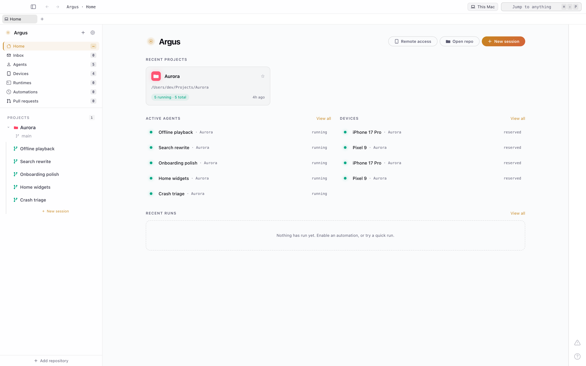
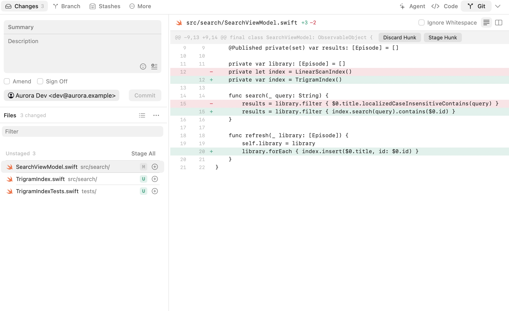
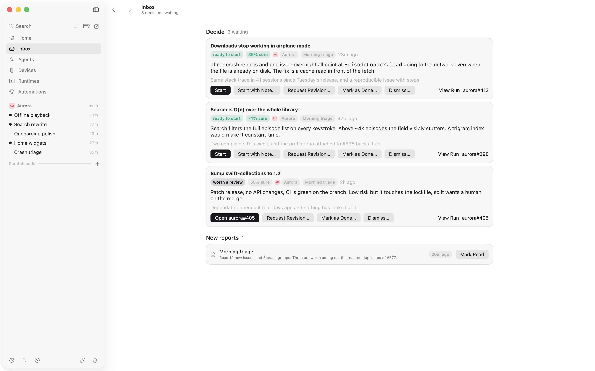
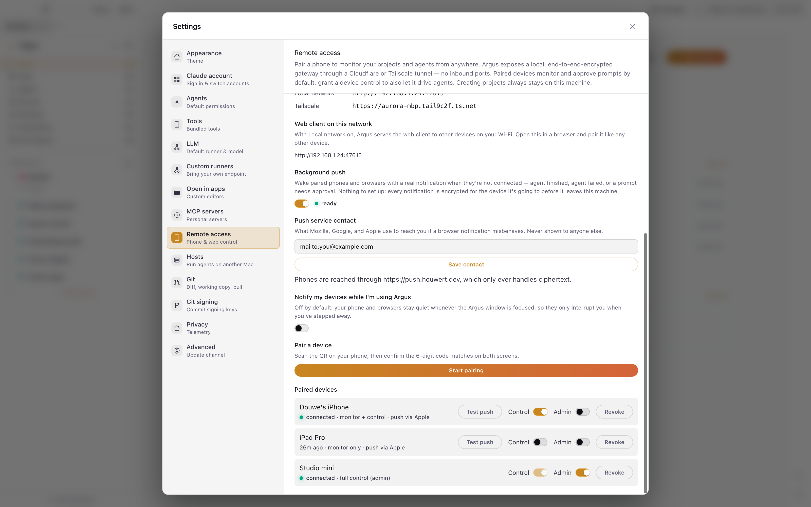

<div align="center">


# Argus

### Run a flock of agents. Watch every one.

Argus gives every Claude Code agent its own git worktree and its own browser, iOS simulator or Android
emulator — then lets it click, tap, type and scroll through the app it just built.
Run five at once, watch them work on real devices, review the diffs, merge what survives.

<a href="https://houwert.dev/argus"></a>
<a href="https://houwert.dev/argus/docs"></a>


[](LICENSE)

<br />

<picture>
  <source media="(prefers-color-scheme: dark)" srcset="shots/out/flock-poster@dark.png" />
  
</picture>

</div>

<br />

<div align="center">

**Five agents, five worktrees, five devices — at once** · **The agent clicks through the app it just
built** · **Hand a teammate one agent, not your whole machine** · **Runs headless on a Mac mini;
drive it from your phone**

</div>

---

## Why

Coding agents are fast. What slows you down is the juggling — stashing to switch branches,
resetting a simulator between attempts, waiting for one idea to finish before the next can start,
poking at a device by hand to see if it worked. Death by a thousand context switches.

Argus opens another eye for each of those.

|                             |                                                                                                                                                                                      |
| --------------------------- | ------------------------------------------------------------------------------------------------------------------------------------------------------------------------------------ |
| **Parallel by default**     | Every session is an isolated worktree with its own agent, its own device, its own terminals. Fan out five ideas at once; none of them collide.                                       |
| **See what the agent sees** | Live iOS simulator and Android emulator mirroring, an embedded Chromium browser over CDP, and streaming tool-call cards — the agent's every move, rendered as it happens.            |
| **Review like a human**     | Branches, commits, stashes, hunk-level staging, and a diff viewer, all in the UI. Accept, reject, or refine without leaving the app.                                                 |
| **Not tied to your desk**   | Pair a phone or a browser and check in from anywhere, hand a Mac mini the work with the headless server build, or drop someone a temporary link to exactly one agent and one device. |

Beyond the four: automations that start the work themselves, an orchestration tree for
agent-spawned subagents, a permission broker with per-pattern allow/deny, organisations for
multi-repo products, and a built-in MCP server. See [`docs/features.md`](docs/features.md).

---

## Read the diff, not the promise

An agent telling you it worked is not evidence. Every session carries a full git client — file
list, unified or split diff, hunk-level staging, commits, stashes, conflicts — so you approve the
branch that survives and throw the rest away without leaving the app.

<picture>
  <source media="(prefers-color-scheme: dark)" srcset="shots/out/review-detail@dark.png" />
  
</picture>

## The work that starts before you do

Automations run on a schedule or a signal, read your issues, pull requests and crash reports, and
leave proposals in an inbox — each with a confidence, a rationale and the source it came from. An
autonomy ladder decides how far a run may go on its own: propose, draft, open a PR, or merge when
CI is green.

<picture>
  <source media="(prefers-color-scheme: dark)" srcset="shots/out/automations-poster@dark.png" />
  
</picture>

## Your Mac keeps working while you don't

Pair a phone or any browser and check in from anywhere. Local network, Tailscale and Cloudflare run
side by side; traffic is end-to-end encrypted with Noise IK, so a tunnel only ever sees ciphertext.
Or hand a Mac mini the job with the headless server build.

<picture>
  <source media="(prefers-color-scheme: dark)" srcset="shots/out/remote-poster@dark.png" />
  
</picture>

---

## Install

<details open>
<summary><b>Prerequisites</b></summary>

- macOS 15+ (Apple Silicon)
- [mise](https://mise.jdx.dev/) — pins Node 24 and pnpm 10 (see `mise.toml`)
- [Claude Code CLI](https://docs.anthropic.com/en/docs/claude-code) on your `PATH`, with your own
  subscription or API key
- Xcode + iOS Simulators for the iOS features; Android SDK + an AVD for Android (optional)

</details>

```sh
mise install        # node, pnpm
pnpm install        # dependencies + conductor + scrcpy-server bootstrap
pnpm build:bridge   # native iOS capture bridge (required for simulator mirroring)
```

### Run

Argus for Mac is the desktop app: open `clients/apple/ArgusRemote.xcodeproj` and run the
`ArgusDesktop` scheme, or build it from the command line. A Debug build ("Argus Dev") keeps its
state in `~/.argus-mac-dev`, apart from an installed Argus.

```sh
xcodebuild -project clients/apple/ArgusRemote.xcodeproj -scheme ArgusDesktop \
  -destination 'platform=macOS' build
pnpm dev:host       # the host core on its own, as a plain Node process
pnpm lint           # tsc + eslint + prettier + CSS-module and cycle checks
pnpm test           # vitest
pnpm storybook      # Peacock design system at :6006
pnpm shots          # regenerate the product screenshots (see below)
```

The project is signed with the maintainer's Apple team. To build with your own team, or ad-hoc
signed with no team at all, see [Building Argus for Mac](CONTRIBUTING.md#building-argus-for-mac-without-the-maintainers-apple-team).
The simulator bridge relies on Apple's private CoreSimulator and SimulatorKit frameworks, so a new
Xcode release can break it.

Argus for Mac replaced the Electron app in v0.72.0; the Electron app has since been removed from
the repo, and existing Electron installs update into Argus for Mac.

---

## Configure a project: `.argus.json`

Drop this in any repo root to make it Argus-ready:

```json
{
  "setup": {
    "copy": ["node_modules", "Pods"],
    "symlink": [".env", ".env.local"],
    "commands": ["pnpm install --frozen-lockfile"]
  },
  "terminals": [{ "name": "Shell", "dir": "." }],
  "workspace_env": {
    "name": "PORT",
    "base_value": 3000,
    "range": 100,
    "strategy": "sequential"
  },
  "run": "pnpm start"
}
```

| Field            | Purpose                                                                        |
| ---------------- | ------------------------------------------------------------------------------ |
| `setup.copy`     | Dirs/files copied into each new worktree (globs; `{ path, exclude }` to prune) |
| `setup.symlink`  | Files symlinked from the main repo (globs; same object form as `copy`)         |
| `setup.commands` | Shell commands run after copy/symlink                                          |
| `terminals`      | Tabs auto-opened per session (name + working dir)                              |
| `workspace_env`  | Env var set per-session with a unique port/offset                              |
| `run`            | Command executed by the Run button                                             |

`.argus.local.json` (gitignored) overrides or extends the base config. Everything here is also
editable in-app under Project Settings; the full reference is in
[`docs/project-settings.md`](docs/project-settings.md).

---

## Architecture

A pnpm monorepo of the host core, its clients and the design system, behind a three-panel desktop app: workspace sidebar on the left, agent control in
the center, runtime and testing on the right.

| Package             | What it is                                                                                     |
| ------------------- | ---------------------------------------------------------------------------------------------- |
| `packages/host`     | `@argus/host` — sessions, agents, git, terminals, simulators, command registry. **Plain Node** |
| `packages/peacock`  | `@argus/peacock` — the design system: tokens, icons, components                                |
| `clients/apple`     | Argus for Mac (the desktop app) and the iPhone client, in SwiftUI                              |
| `clients/argus-web` | The web client                                                                                 |
| `native/`           | Swift/ObjC simulator bridge                                                                    |

The interesting constraint is that **`packages/host` is plain Node** — it never imports a desktop
shell (`packages/host/src/noElectron.test.ts` and a `no-restricted-imports` rule keep it that way).
Anything the desktop shell alone can do (open a browser, reach the keychain, post a notification) goes through the
`HostPlatform` seam in `packages/host/src/platform.ts`, which has a headless Node implementation
where every capability degrades to a documented no-op. A Linux box or a bare CLI can run the core.

Host services live one directory per domain under `packages/host/src/services/`: `session/`
(worktrees, setup, merge), `agent/` (the Claude Code subprocess and its stream-json), `terminal/`
(node-pty), `simulator/` (simctl plus the native bridge), `command/` (the registry), `remote/` (the
Noise/WS gateway), and about twenty more.

`CLAUDE.md` has the full map, the conventions, and the rules that matter when adding to any of it.

### Session lifecycle

1. **Create** — `git worktree add` from the base branch.
2. **Setup** — the `.argus.json` pipeline runs: copy, symlink, commands.
3. **Work** — the agent works in the worktree; terminals, simulator, and browser attach automatically.
4. **Review** — inspect the diff, stage hunks, commit, optionally stash.
5. **Merge** — one-click merge back into the base branch.
6. **Delete** — kills the agent and terminals, removes the worktree.

Worktrees live at `~/.argus/worktrees/{RepoName}-argus-worktrees/{branch}/`, outside your project
directory, so your primary checkout and your git client stay clean.

<details>
<summary><b>Key technical decisions</b></summary>

<br />

| Decision                                   | Why                                                               |
| ------------------------------------------ | ----------------------------------------------------------------- |
| `node-pty` for terminals                   | Same as VS Code — fast spawn, reliable PTY                        |
| Git CLI over libgit2                       | libgit2's worktree support is incomplete                          |
| Claude Code as a `stream-json` subprocess  | Structured events over piped stdio, not a fragile interactive PTY |
| Native binary for the iOS simulator bridge | Private CoreSimulator frameworks are unreachable from Node.js     |
| Worktrees outside the project directory    | Keeps the user's repo and git client clean                        |
| `packages/host` as plain Node              | The core runs headless — a Linux box or a CLI can host it         |
| Noise IK for the remote gateway            | The tunnel only ever sees ciphertext; keys are pinned per device  |
| MCP server baked in                        | Any MCP-aware agent can drive Argus sessions out of the box       |

</details>

<details>
<summary><b>Screenshots are generated, not taken</b></summary>

<br />

`pnpm shots` builds Argus for Mac (Debug) and attaches it, as a second window, to a small fixture
host: a stand-in for the host core that answers the app's socket from canned data. No real
sessions, no Claude auth, no simulator — so the output is identical run to run and safe to publish.
The app captures nothing itself; the runner shoots its window through WindowServer, so whoever runs
it needs Screen Recording permission.

Scenarios with a `beats` list are **recorded**: the runner pushes one beat's events at a time,
screenshots between steps, and stitches the frames with ffmpeg — a scripted sequence is
reproducible in a way a screen recording never is.

Scenarios are plain data in `scripts/shots/fixture/scenarios/`; `scripts/shots/` turns them into what the
Mac app asks for, with real git repos behind the worktrees for the Git view. To add a shot, add a
scenario (and, if the Mac needs it, an entry in `scripts/shots/scenes.ts`) and run `pnpm shots`.
`pnpm shots --check` compares against the committed images, so a UI change that breaks the README or
the website fails the build instead of rotting quietly. `--no-build` reuses the last build and
`--only <id>` runs one scenario.

</details>

---

## Contributing

Argus is small, opinionated, and moving fast, which makes it a good time to join. Agent orchestration,
the simulator pipeline, a new MCP primitive, an icon in Peacock, a thoughtful bug report: all of it
counts.

Start with [CONTRIBUTING.md](CONTRIBUTING.md) for setup, conventions and how PRs land; `CLAUDE.md`
is the full map of the codebase. Everyone taking part follows the [Code of Conduct](CODE_OF_CONDUCT.md).
Found a security issue? Report it privately, as described in [SECURITY.md](SECURITY.md).

## Telemetry and privacy

Argus asks on first launch how much it may send. The floor is one anonymous heartbeat per launch
(a random install id and the app version); opting in to full telemetry adds feature-usage events and
scrubbed errors. Prompts, code, agent output, names, paths and URLs are never sent. Every event and
property is listed in [`docs/telemetry-events.md`](docs/telemetry-events.md).

Builds from source send nothing at all: the analytics key is only injected into official releases.

## License

[MIT](LICENSE) © Douwe Bos. Vendored third-party code keeps its own license, next to the code.

---

<div align="center">

> _In the myth, Argus Panoptes had a hundred eyes — some always open, some always watching. When he
> was slain, the goddess Hera set his eyes into the tail of the peacock, where they glitter to this
> day._
>
> _This repo is those eyes. The [`@argus/peacock`](./packages/peacock) design system is where they
> live._

</div>
