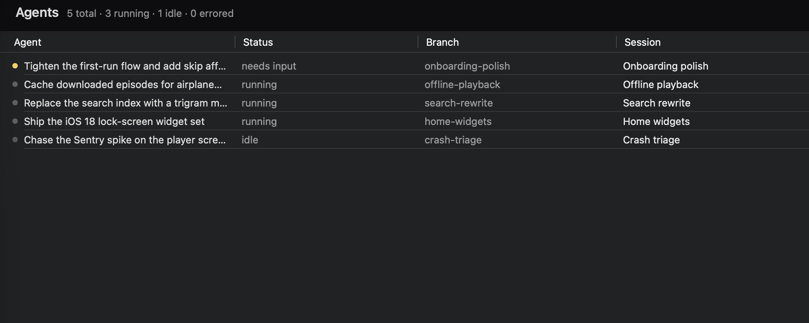
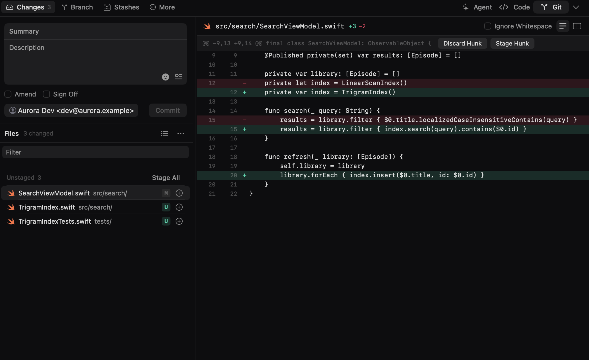

# Argus

**Run a flock of agents. Watch every one.**

Argus gives every Claude Code agent its own git worktree and its own iOS simulator or Android emulator — then lets it tap, type and scroll through the app it just built. Run five at once, watch them work on real devices, review the diffs, merge what survives.



## Why

Coding agents are fast. What slows you down is the juggling — stashing to switch branches, resetting a simulator between attempts, waiting for one idea to finish before the next can start, poking at a device by hand to see if it worked. Death by a thousand context switches.

Argus opens another eye for each of those:

- **Parallel by default.** Every session is an isolated worktree with its own agent, its own device, its own terminals. Fan out five ideas at once; none of them collide.
- **See what the agent sees.** Live iOS simulator and Android emulator mirroring, an embedded Chromium browser over CDP, and streaming tool-call cards — the agent's every move, rendered as it happens.
- **Review like a human.** Branches, commits, stashes, hunk-level staging, and a diff viewer, all in the UI. Accept, reject, or refine without leaving the app.
- **Not tied to your desk.** Pair a phone or a browser and check in from anywhere, hand a Mac mini the work with the headless server build, or drop someone a temporary link to exactly one agent and one device. End-to-end encrypted, your machines only.



Beyond the four: automations that start the work themselves, an orchestration tree for agent-spawned subagents, a permission broker with per-pattern allow/deny, organisations for multi-repo products, and a built-in MCP server. See [`docs/features.md`](docs/features.md).

## Install

**Prerequisites**

- macOS 13+ (Apple Silicon)
- [mise](https://mise.jdx.dev/) — pins Node 24 and pnpm 10 (see `mise.toml`)
- [Claude Code CLI](https://docs.anthropic.com/en/docs/claude-code) on your `PATH`, with your own subscription or API key
- Xcode + iOS Simulators for the iOS features; Android SDK + an AVD for Android (optional)

```sh
mise install        # node, pnpm
pnpm install        # dependencies + conductor + scrcpy-server bootstrap
pnpm build:bridge   # native iOS capture bridge (required for simulator mirroring)
```

## Run

```sh
pnpm dev            # Vite dev server + Electron
pnpm build          # type-check + Vite build + Electron compile
pnpm build:app      # produce .app / .dmg via electron-builder
pnpm lint           # tsc + eslint + prettier + CSS-module and cycle checks
pnpm test           # vitest
pnpm storybook      # Peacock design system at :6006
pnpm shots          # regenerate the product screenshots (see below)
```

## Configure a project: `.argus.json`

Drop this in any repo root to make it Argus-ready:

```json
{
  "setup": {
    "copy": ["node_modules", "Pods"],
    "symlink": [".env", ".env.local"],
    "commands": ["pnpm install --frozen-lockfile"]
  },
  "terminals": [{ "name": "Shell", "dir": "." }],
  "workspace_env": {
    "name": "PORT",
    "base_value": 3000,
    "range": 100,
    "strategy": "sequential"
  },
  "run": "pnpm start"
}
```

| Field            | Purpose                                                                        |
| ---------------- | ------------------------------------------------------------------------------ |
| `setup.copy`     | Dirs/files copied into each new worktree (globs; `{ path, exclude }` to prune) |
| `setup.symlink`  | Files symlinked from the main repo (globs; same object form as `copy`)         |
| `setup.commands` | Shell commands run after copy/symlink                                          |
| `terminals`      | Tabs auto-opened per session (name + working dir)                              |
| `workspace_env`  | Env var set per-session with a unique port/offset                              |
| `run`            | Command executed by the Run button                                             |

`.argus.local.json` (gitignored) overrides or extends the base config. Everything here is also editable in-app under Project Settings; the full reference is in [`docs/project-settings.md`](docs/project-settings.md).

## Architecture

A pnpm monorepo behind a three-panel desktop shell: workspace sidebar on the left, agent control in the center, runtime and testing on the right.

| Package            | What it is                                                                                     |
| ------------------ | ---------------------------------------------------------------------------------------------- |
| `packages/host`    | `@argus/host` — sessions, agents, git, terminals, simulators, command registry. **Plain Node** |
| `packages/peacock` | `@argus/peacock` — the design system: tokens, icons, components                                |
| `app/`             | React 19 + Vite renderer                                                                       |
| `electron/`        | Thin desktop shell — window lifecycle and the bridges into the host                            |
| `clients/`         | The LAN web client and the native Expo remote                                                  |
| `native/`          | Swift/ObjC simulator bridge                                                                    |

The interesting constraint is that **`packages/host` never imports `electron`** — enforced by `packages/host/src/noElectron.test.ts` and a `no-restricted-imports` rule. Anything the desktop shell alone can do (open a browser, reach the keychain, post a notification) goes through the `HostPlatform` seam in `packages/host/src/platform.ts`, which has a headless Node implementation where every capability degrades to a documented no-op. A Linux box or a bare CLI can run the core.

Host services live one directory per domain under `packages/host/src/services/`: `session/` (worktrees, setup, merge), `agent/` (the Claude Code subprocess and its stream-json), `terminal/` (node-pty), `simulator/` (simctl plus the native bridge), `command/` (the registry), `remote/` (the Noise/WS gateway), and about twenty more.

`CLAUDE.md` has the full map, the conventions, and the rules that matter when adding to any of it.

## Session lifecycle

1. **Create** — `git worktree add` from the base branch.
2. **Setup** — the `.argus.json` pipeline runs: copy, symlink, commands.
3. **Work** — the agent works in the worktree; terminals, simulator, and browser attach automatically.
4. **Review** — inspect the diff, stage hunks, commit, optionally stash.
5. **Merge** — one-click merge back into the base branch.
6. **Delete** — kills the agent and terminals, removes the worktree.

Worktrees live at `~/.argus/worktrees/{RepoName}-argus-worktrees/{branch}/`, outside your project directory, so your primary checkout and your git client stay clean.

## Key technical decisions

| Decision                                   | Why                                                               |
| ------------------------------------------ | ----------------------------------------------------------------- |
| `node-pty` for terminals                   | Same as VS Code — fast spawn, reliable PTY                        |
| Git CLI over libgit2                       | libgit2's worktree support is incomplete                          |
| Claude Code as a `stream-json` subprocess  | Structured events over piped stdio, not a fragile interactive PTY |
| Native binary for the iOS simulator bridge | Private CoreSimulator frameworks are unreachable from Node.js     |
| Worktrees outside the project directory    | Keeps the user's repo and git client clean                        |
| `packages/host` free of Electron           | The core runs headless — a Linux box or a CLI can host it         |
| Noise IK for the remote gateway            | The tunnel only ever sees ciphertext; keys are pinned per device  |
| MCP server baked in                        | Any MCP-aware agent can drive Argus sessions out of the box       |

## Screenshots are generated, not taken

`pnpm shots` renders the real app in a plain browser tab against fixture data and captures it with [conductor](https://github.com/DouweBos/conductor). No Electron, no backend, no Claude auth, no simulator — so the output is identical run to run and safe to publish.

Scenarios with a `beats` list are **recorded**: the runner steps the fixture one beat at a time, screenshots between steps, and stitches the frames with ffmpeg. Conductor only records real devices, and a timed screen capture of a web page is not reproducible — a scripted sequence is.

Scenarios are plain data in `app/lib/fixture/scenarios/`, reached via `?fixture=<id>`; `app/lib/fixture/stubBridge.ts` stands in for the preload bridge. To add a shot, add a scenario and run `pnpm shots`. `pnpm shots --check` compares against the committed images, so a UI change that breaks the README or the website fails the build instead of rotting quietly.

## Contributing

We just welcomed our first collaborator, so Argus is officially a flock — two pairs of eyes and room for more.

Argus is small, opinionated, and moving fast — which is the best time to join. Agent orchestration, the simulator pipeline, a new MCP primitive, an icon in Peacock, a thoughtful bug report: all of it counts.

A few ground rules (the full list is in `CLAUDE.md`):

- **Peacock first.** All UI primitives come from [`@argus/peacock`](./packages/peacock). No inline `<svg>` in `app/`, no Tailwind, no ad-hoc icon packs.
- **Keep files focused.** ~500 LOC is the soft ceiling for a module, ~300 for a component. If it's growing, split it.
- **Typed IPC everywhere.** Handlers in `packages/host/src/services/`, registered in `electron/ipc.ts`, wrapped in `app/lib/ipc.ts`. Keep `types.ts` in sync.
- **Worktrees are sacred.** Changes to the worktree lifecycle touch real user repos. Tread lightly, and test with `pnpm dev` first.
- **Tokens only.** No hardcoded colors — they silently break the opposite theme.

---

> _In the myth, Argus Panoptes had a hundred eyes — some always open, some always watching. When he was slain, the goddess Hera set his eyes into the tail of the peacock, where they glitter to this day._
>
> _This repo is those eyes. The [`@argus/peacock`](./packages/peacock) design system is where they live._
